# 
📄 Awesome Document Tracking & Sales Enablement 🚀

  
  
  
  
  
  

  

  <strong>Curated directory of top Open-Source tools & enterprise SaaS platforms for Document Tracking, Digital Sales Rooms (DSR), E-Signature workflows, and Modern Revenue Enablement.</strong>

  <em>Discover self-hosted DocSend alternatives, page-level buyer analytics, dynamic proposal engines, and deal room security architectures.</em>

---

## 📑 Table of Contents

- [🌟 Overview](#-overview)
- [📊 Sector Overview & Market Dynamics](#-sector-overview--market-dynamics)
- [🏢 SaaS & Hosted Platforms](#-saashosted-platforms)
- [🔓 Open-Source GitHub Projects](#-open-source-github-projects)
- [💡 Architectural Guide & Buyer Criteria](#-architectural-guide--buyer-criteria)
- [🤝 How to Contribute](#-how-to-contribute)
- [💖 Support & Sponsorship](#-support--sponsorship)
- [📈 Star History](#-star-history)
- [⚖️ Disclaimer](#️-disclaimer)

---

## 🌟 Overview

In high-velocity B2B sales, revenue operations, and venture capital, **buyer engagement telemetry** determines deal velocity. Sharing static PDF attachments blinds sales teams to reader interest. **Document tracking platforms** and **modern sales enablement suites** bridge this gap by offering:

- ⏱️ **Page-Level Analytics**: Millisecond-accurate telemetry revealing which slides prospects scrutinize and where drop-off occurs.
- 🔒 **Secure Digital Sales Rooms (DSR)**: Watermarked, gated spaces protected by email verification, domain whitelists, password gates, and NDA click-wraps.
- ✍️ **Integrated Proposal & E-Sign Workflows**: Unified engines merging CPQ pricing tables, interactive calculators, and legal signature capture.
- 🛡️ **Self-Hosted Privacy**: Open-source stacks providing full ownership of sensitive pitch decks, M&A due diligence documents, and enterprise contracts.

---

## 📊 Sector Overview & Market Dynamics

The global Sales & Revenue Enablement Platform market is valued at approximately **$3.5B–$4.5B** (projected to exceed **$7.0B+** by 2028 growing at an ~18% CAGR). 

The sector displays a **bifurcated, moderately fragmented market structure**:
- 🏛️ **Enterprise Enablement (High Concentration)**: The high-end enterprise segment exhibits consolidation around a few dominant players (**Highspot**, **Seismic**, **Showpad**), which command substantial annual contracts ($30k–$100k+ floors) through combined content governance, LMS training, and conversation intelligence suites.
- 🚀 **Specialized Point Solutions & Deal Rooms (High Fragmentation)**: The SMB and mid-market landscape remains fragmented across dedicated tools specializing in page-level tracking (**DocSend**), dynamic web proposals (**PandaDoc**, **Qwilr**, **Proposify**), and interactive digital sales rooms (**GetAccept**, **Paperflite**). Concurrently, privacy-first open-source alternatives like **Papermark** and **DocuSeal** are accelerating self-hosted adoption.

---

## 🏢 SaaS/Hosted Platforms

*Commercial platforms ranked in descending order of company scale (market capitalization / valuation / ARR).*

| Platform | Company Size (Valuation / Revenue) | Starting Tier Pricing | Free Tier / Trial Limits | Key Features & Focus | Best For & Trade-offs |
| :--- | :--- | :--- | :--- | :--- | :--- |
| **HubSpot Document Tracking** | **$21.0B+ Market Cap** (~$3.1B ARR) | **$15/seat/month** (Sales Hub Starter, billed annually) | **Free Forever plan**: Limited to 5 uploaded account documents shared across 2 free CRM seats | Document sharing, open notifications, link access controls, CRM activity timeline logging | **Best for:** Existing HubSpot CRM users valuing CRM context over page-level detail. **Trade-off:** No time-per-page analytics; public links not suited for high-stakes confidential deal rooms. |
| **Highspot** | **$3.5B Valuation** (~$250M–$450M ARR) | **~$45–$65/user/month** (Quote-only; min. ~$50k/yr annual contract + $15k–$45k onboarding) | **Demo only** (No public self-serve trial; enterprise sales pilot/PoC on request) | Content governance, sales playbooks, buyer engagement analytics, AI training & coaching | **Best for:** Enterprise GTM teams wanting content governance plus sales training. **Trade-off:** High entry floor (50+ user minimums, hefty setup fees). |
| **Seismic** | **$3.0B Valuation** (~$400M ARR) | **~$40–$75/user/month** (Quote-only; min. ~$30k–$45k/yr contract + $10k+ onboarding) | **Demo only** (No public self-serve trial; enterprise sales pilot/PoC on request) | Enterprise enablement cloud, content automation, digital sales rooms, training & readiness | **Best for:** Large enterprise organizations needing unified enablement and compliance. **Trade-off:** Enterprise-only pricing floor; long procurement and implementation cycles. |
| **DocSend** *(Dropbox)* | **$165M Acquisition Valuation** (Dropbox: ~$8B Market Cap, DocSend ~$20M+ ARR) | **$10/user/month** (Personal plan, billed annually) | **14-day free trial** (Full access to advanced tracking and data room features; no free forever plan) | Page-level engagement analytics, secure document links, NDA signing, basic/advanced virtual data rooms | **Best for:** Teams needing granular page-level engagement data and secure deal rooms. **Trade-off:** Per-user costs scale rapidly; advanced deal rooms require $150–$180/mo tiers. |
| **PandaDoc** | **$1.0B Valuation** (~$100M+ ARR) | **$19/seat/month** (Starter plan, billed annually) | **Free Forever plan**: 5 documents/month, e-signatures, payment collection, and real-time tracking | Document lifecycle management, proposal templates, quote generation, native e-signatures | **Best for:** Teams wanting authoring, pricing tables, tracking, and signing in one unified platform. **Trade-off:** CRM integrations and digital sales rooms require the Business tier ($49/seat/mo). |
| **Showpad** | **$1.0B Valuation** (~$100M–$145M ARR) | **~$30–$37/user/month** (Quote-only baseline; annual commitment + $8k–$40k onboarding) | **Demo only** (No public self-serve trial; guided product demo on request) | Content hub, digital sales rooms, seller coaching/readiness, AI content governance | **Best for:** Mid-market to enterprise teams wanting enablement with lower onboarding costs than Highspot. **Trade-off:** AI and coaching features gated to higher Advanced/Expert tiers. |
| **GetAccept** | **~$100M Valuation Est.** ($30M+ raised, ~$15M–$18M ARR) | **$25/user/month** (eSign plan, billed annually) | **14-day free trial** (Access to digital sales room and document tracking features) | Digital sales rooms, video messaging, proposal tracking, contract execution, e-signatures | **Best for:** Teams wanting interactive buyer deal rooms with integrated video and e-sign. **Trade-off:** Professional plan requires a 5-user minimum ($245/mo entry floor). |
| **Paperflite** | **~$50M–$75M Valuation Est.** (~$15M ARR) | **$30/user/month** (Starter plan, billed annually) | **14-day free trial** (Access to content hub and audience engagement tracking) | Content management, engagement analytics, AI discovery, customized digital deal rooms | **Best for:** Content-heavy sales and marketing teams wanting asset engagement analytics. **Trade-off:** Deal rooms and predictive insights require the Advanced tier ($60/user/mo). |
| **Qwilr** | **~$50M–$70M Valuation Est.** ($8.9M raised, ~$13M–$18M ARR) | **$35/user/month** (Starter plan, billed annually) | **14-day free trial** (Full creation and tracking of interactive web proposals) | Interactive web-based proposals, dynamic quote blocks, page view & section analytics, e-signature | **Best for:** Teams wanting modern web-based proposals replacing static PDF quotes. **Trade-off:** Higher seat minimums on upper tiers (Growth requires 5 seats, Scale requires 10 seats). |
| **Proposify** | **~$40M–$60M Valuation Est.** ($13M raised, ~$8M–$10M ARR) | **$9/user/month** (Basic/integrations entry tier, up to $35/user/mo) | **14-day free trial** (Full access to proposal templates, metrics, and tracking; no credit card required) | Proposal template builder, document tracking, interactive pricing, e-signatures | **Best for:** Agencies and sales teams focused specifically on proposal creation and win-rate metrics. **Trade-off:** Focused on proposals; narrower than complete revenue enablement suites. |

---

## 🔓 Open-Source GitHub Projects

*Self-hosted open-source repositories sorted in descending order of GitHub stargazers count.*

### 1. [Twenty](https://github.com/twentyhq/twenty) 
> **The modern open-source CRM alternative to Salesforce & HubSpot, designed for AI-driven revenue enablement.**
- 💻 **Tech Stack:** TypeScript, React, NestJS, GraphQL, PostgreSQL
- 📜 **License:** AGPL-3.0
- 🚀 **Key Capabilities:** Flexible relational data model linking leads, opportunities, and sales collateral; custom object pipelines; native activity logging and note tracking.
- 🎯 **Best For:** Sales teams desiring full data sovereignty over CRM workflows with complete API extensibility.

---

### 2. [Paperless-ngx](https://github.com/paperless-ngx/paperless-ngx) 
> **Community-supported open-source document management system (DMS) with automated indexing and OCR.**
- 💻 **Tech Stack:** Python, Django, Angular, Tesseract OCR, Redis, PostgreSQL
- 📜 **License:** GPL-3.0
- 🚀 **Key Capabilities:** Automated document ingestion, full-text OCR indexing, machine-learning powered tagging, metadata matching, and audit-ready document archiving.
- 🎯 **Best For:** Archiving, managing, and categorizing collateral, contracts, and inbound customer agreements.

---

### 3. [DocuSeal](https://github.com/docusealco/docuseal) 
> **Open-source digital signature and document workflow engine (DocuSign & PandaDoc e-sign alternative).**
- 💻 **Tech Stack:** Ruby on Rails, Stimulus, PostgreSQL
- 📜 **License:** AGPL-3.0 / Commercial
- 🚀 **Key Capabilities:** PDF document field authoring, visual drag-and-drop form builder, automated email reminders, mobile-friendly signing, and cryptographic audit trails.
- 🎯 **Best For:** Teams building embedded contract signing and proposal execution pipelines without recurring per-signature fees.

---

### 4. [Documenso](https://github.com/documenso/documenso) 
> **Modern, clean open-source digital document signing infrastructure.**
- 💻 **Tech Stack:** TypeScript, Next.js, Prisma, Tailwind CSS, PostgreSQL
- 📜 **License:** AGPL-3.0
- 🚀 **Key Capabilities:** Public/private document signing, webhook integrations, team workspace management, custom branding, and developer-friendly REST/GraphQL APIs.
- 🎯 **Best For:** Developers embedding compliant document signing workflows directly into web applications.

---

### 5. [Papermark](https://github.com/papermark/papermark) 
> **The premier open-source DocSend alternative featuring page-level telemetry and virtual data rooms (VDR).**
- 💻 **Tech Stack:** Next.js 14, TypeScript, Prisma, Tailwind CSS, PostgreSQL
- 📜 **License:** AGPL-3.0
- 🚀 **Key Capabilities:** 
  - **Granular Page Analytics**: Precise duration tracking per slide/page, view counts, and reader completion heatmaps.
  - **Link Security**: Gated links with mandatory email capture, password protection, expiration dates, and download restrictions.
  - **Deal Rooms**: Branded virtual data rooms for diligence, multi-document collections, and custom domain mapping (`docs.yourbrand.com`).
  - **Security Safeguards**: Watermarking, allow/block domain lists, and AI crawler blocking.
- 🎯 **Best For:** Pitch decks, investor relations, confidential sales proposals, and teams seeking DocSend features with self-hosted data ownership.

---

### 6. [OpenSign](https://github.com/OpenSignLabs/OpenSign) 
> **Free and open-source document signing solution for teams and enterprises.**
- 💻 **Tech Stack:** Node.js, Express, React, MongoDB
- 📜 **License:** AGPL-3.0
- 🚀 **Key Capabilities:** Secure electronic signatures, audit trails, document templates, signer delegation, and custom SMTP integration.
- 🎯 **Best For:** Organizations seeking an easy-to-deploy self-hosted e-signature portal.

---

### 7. [Docbase](https://github.com/alanagoyal/docbase) 
> **Lightweight, developer-friendly open-source DocSend alternative tailored for pitch deck sharing.**
- 💻 **Tech Stack:** TypeScript, Next.js, Vercel, Supabase
- 📜 **License:** MIT
- 🚀 **Key Capabilities:** Minimalist PDF sharing, viewer email gating, basic slide duration tracking, and clean viewer UI.
- 🎯 **Best For:** Founders and developers wanting an uncluttered, zero-bloat deck sharing app.

---

### 8. [Hashdocs](https://github.com/hashdocs/hashdocs) 
> **Open-source secure document sharing and tracking platform with advanced link governance.**
- 💻 **Tech Stack:** TypeScript, Next.js, Node.js, PostgreSQL
- 📜 **License:** Apache-2.0
- 🚀 **Key Capabilities:** Dynamic link-level permission revocation, recipient tracking, viewer engagement graphs, and anti-forwarding access gates.
- 🎯 **Best For:** Security-focused teams requiring open Apache-2.0 licensed document tracking.

---

### 9. [Proponent](https://github.com/pkmohite/Proponent) 
> **NLU-powered open-source sales enablement and prospect messaging assistant.**
- 💻 **Tech Stack:** Python, Streamlit, OpenAI API
- 📜 **License:** MIT
- 🚀 **Key Capabilities:** AI content generation tailored to prospect persona, sales messaging alignment, and customer profile analysis.
- 🎯 **Best For:** Product-led growth and SDR teams generating targeted outreach collateral.

---

## 💡 Architectural Guide & Buyer Criteria

Selecting the right platform depends on your operational bottlenecks:

1. **Document Trackers vs. Proposal Platforms vs. Enablement Suites**:
   - 🔍 **Document Trackers** (*DocSend, Papermark, Hashdocs*): Designed to share static files (PDFs, PPTXs) and collect precise telemetry (time spent per slide).
   - 📝 **Proposal Engines** (*PandaDoc, Qwilr, Proposify, DocuSeal*): Built for collaborative document authoring, CPQ pricing tables, interactive web presentation, and e-signature execution.
   - 🏢 **Sales Enablement Clouds** (*Highspot, Seismic, Showpad*): Comprehensive enterprise operating systems combining internal content repositories, AI coaching, rep certifications, and external buyer engagement.

2. **Self-Hosted vs. Cloud Trade-offs**:
   - ⚡ **Email Scanner Inflation**: Automated enterprise email security bots (e.g., Proofpoint, Barracuda) click links and trigger tracking pings. Ensure your tracking platform includes bot/crawler filtering.
   - 🛡️ **Data Sovereignty**: For M&A transactions, proprietary IP, and healthcare/financial agreements, self-hosted platforms (**Papermark**, **DocuSeal**) ensure confidential materials remain on your private cloud.

---

## 🤝 How to Contribute

We welcome additions, corrections, and updates from the community!

1. 🍴 **Fork the repository**.
2. 🌿 **Create a descriptive feature branch** (`git checkout -b feat/add-awesome-tool`).
3. 📝 **Add or edit entries in `README.md`**:
   - Maintain alphabetical or logical ordering.
   - For SaaS products, include verifiable starting prices and explicit free tier/trial limits.
   - For open-source repos, link repo stars badge with `style=social&color=white` and stargazers link.
4. 🚀 **Commit your changes** (`git commit -m "feat: add NewTool to open-source list"`).
5. 📤 **Push to your branch** (`git push origin feat/add-awesome-tool`).
6. 🔀 **Open a Pull Request** with a concise description of why the tool belongs in this list.

---

## 💖 Support & Sponsorship

If you find this curated collection helpful for your sales architecture or engineering stack, please consider supporting the project:

- 🌟 **Star this repository** on GitHub to help others discover it!
- 🍴 **Fork and share** with fellow revenue operations leaders, sales engineers, and developers.
- ☕ **Buy a coffee & sponsor ongoing maintenance** via the [GitHub Sponsor Dashboard](https://github.com/sponsors/ishandutta2007).

Thank you to all contributors and community sponsors for keeping this resource up-to-date! 🙌

---

## 📈 Star History

---

## ⚖️ Disclaimer

- This is an independent, **community-curated index** for informational and educational purposes. Mention of specific vendors or products does not constitute a commercial endorsement.
- All product names, logos, and brands are property of their respective owners.
- Ensure all customer-facing document tracking complies with applicable data privacy statutes (GDPR, CCPA, SOC2 Type II) before deployment in production workflows.
